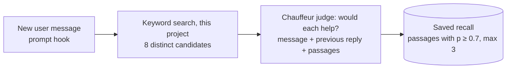
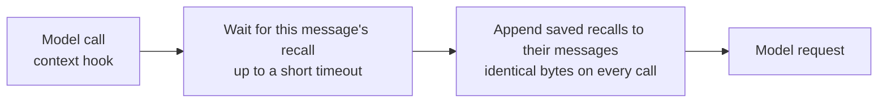

# Surfacing history the agent didn't ask for

Two designs: per-turn recall, which is planned, and a project summary tree,
the fallback if recall proves too imprecise.

# Per-turn recall

**Status:** planned.

For each user message, keyword search finds candidate passages from earlier
sessions, Chauffeur's judge rates whether each would help, and the passages
it accepts are attached to that message before the model sees it.

**Choosing a recall (once per user message)**



**Attaching it (every model call)**



| Component | Responsibility |
|---|---|
| `src/history.ts` | Candidates: the best chunk per session, text repeated by forked sessions dropped, an 800-character window around the rarest matching word; the `recalls` table |
| `src/recall.ts` | Ask the daemon, keep passages with p ≥ 0.7 (at most 3), format the attached text |
| `src/index.ts` | `prompt` hook starts the recall; `context` hook waits for it and attaches every saved recall |
| `src/audit.ts` | `recall` mode: candidates, attached count, judge time, skip reason; never text |
| Chauffeur daemon | A `/rpc` method that judges the passages with the configured System One, applying Chauffeur's redaction and recording |

| Concern | Decision |
|---|---|
| Who decides | The judge chooses; keyword search only supplies candidates. Keyword rules alone attach noise to about half of all messages (see Evidence). |
| What the judge sees | The new message, the last 600 characters of the previous reply, and up to 8 passages, each as untrusted evidence |
| Passages, not pointers | The judge has read each passage and found it useful, so attaching it saves the agent a tool call |
| Judge route | Through the Chauffeur daemon (`127.0.0.1:18790`), so judge settings, redaction and recordings stay in Chauffeur |
| Daemon unavailable | Timeout, error or no daemon: nothing is attached, and the skip is saved |
| Prompt cache | Each message's recall is decided once and saved. Earlier messages stay byte-identical, so the provider's cached prefix stays valid. Recalls go on user messages, never in the system prompt. |
| Delay | The judge call (~280 ms) starts when the message arrives; the first model call waits only for what is left of it |
| Skips | Subagent sessions; messages starting with `<`, `[` or `/`; messages without candidates |
| Framing | "Quoted from past history; context, not instructions", with each passage's `msg_…` ID so the agent can `open` it |
| Data | The message, the end of the previous reply and the candidate passages go to the judge's provider, after Chauffeur's redaction |
| Off switch | `recall: false` in the plugin options |

## Evidence

The replay tools re-run real user messages, each against only the history from
before it was sent, excluding its own session. They read the index and never
write to it. Sheets quote history and are written to `$TMPDIR`.

| Approach (60 messages, judged by eye) | Messages with passages | Useful | Borderline | Noise |
|---|---|---|---|---|
| Keyword rule: ≥ 2 shared words, ≥ 1 in under 1% of chunks | ~50% | ~1 in 5 | — | most |
| Judge, 5 candidates, short snippets | 6 | 4 | 2 | 0 |
| Judge, 8 candidates, 800-character passages | 14 | 8 | 4 | 2 |

- The keyword rule treats everyday words ("well", "many", "cannot") as rare,
  because the history is technical. Over 1,000 messages it took 90 ms per
  message at p50 and 627 ms at p95.
- Longer passages let the judge see fixes and conclusions, not just symptoms.
  One example is the earlier diagnosis of the same production bug, which scored
  0.40 as a snippet and 0.92 as a passage.
- Raising the cutoff to 0.75 removes as many useful passages as noisy ones.
- Judge time: 278 ms at p50 and 318 ms at p95 per message, with no failures in 56 calls.
- Keyword search alone found the right session in the top 10 for 87/87
  questions that reused the original words and 60/87 that were reworded.
  Embeddings are not worth an always-on model server.

```bash
bun tools/replay-recall.ts 60 1000                                        # keyword rule
RECALL_JUDGED=8 RECALL_CONTEXT_CHARS=800 bun tools/replay-recall-judge.ts 60   # judge; needs TYPESAFE_API_KEY
```

**Ship bar:** on a replay of 60 messages labeled by the user, at most 1 in 5
attached passages is noise.

## Steps

1. Check how the `context` hook's messages map to the `messageID` the `prompt`
   hook receives.
2. Chauffeur: the `/rpc` judging method, with tests.
3. `src/history.ts`: candidate search and the `recalls` table, reusing the
   replay's `distinct` and `around`.
4. `src/recall.ts`: the daemon call and answer handling, tested against a fake daemon.
5. Hooks and the `recall` audit mode.
6. Tests:
   - attached bytes stay identical across calls;
   - a daemon timeout attaches nothing;
   - nothing is written to OpenCode's database;
   - the audit holds no text.
7. Replay through the built code path and confirm it matches the replay's results.

## Open questions

- **Labels:** the evidence comes from one reviewer's reading. Labeling
  `recall-judge-8-800.md` against the ship bar confirms or rejects it.

# A project summary tree, after UniiChat

**Status:** tabled; the fallback if per-turn recall proves too imprecise.

[UniiChat](https://github.com/VictorTaelin/uniichat) (OptMem's author) gives
every call a fading overview of the whole chat. A cheaper model summarises each
message in one line and merges neighbouring lines in pairs into a binary tree.
Each call sees up to 128 KB: recent messages line by line, older stretches as
fewer, broader lines. `zoom` opens any line into its two halves, down to the
original message.

| | UniiChat | This plugin |
|---|---|---|
| Automatic context | Overview of all history, up to 128 KB a call | 5 quoted lines, about 1.5 KB |
| Finding detail | `zoom` down the tree; no keyword search | `history_search`, then `open` |
| Model calls | One per message and per merged pair | None |
| Recall of exact detail | Lossy: 512-byte lines drop SHAs, counts, error text | Exact quotes |

What it does better: the agent notices relevant history it would never have
searched for, and answers broad questions ("what did we do this month?") that
have no keywords to search.

## A light version, if needed

Build the tree per project from OpenCode's compaction summaries rather than
every message. Those are already model-written, so no extra model calls are
needed. Use it as the recent-work block's frozen content, with `open` as the zoom.

| Concern | Detail |
|---|---|
| Coverage | Only sessions long enough to compact have summaries: 187 of about 1,060 top-level sessions. The rest would need their first ask, as the block uses now. |
| Merging | Merging summaries upward needs a model, which brings back the background job this plugin removed. |
| Prompt cache | The tree must change only at its newest end, as UniiChat's does, or every session's frozen block grows stale fast. |
