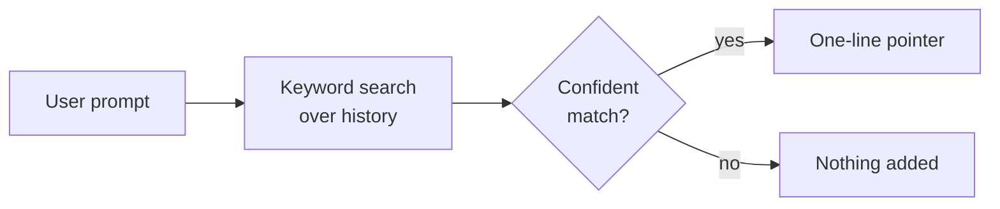

# On hold

Two ideas for surfacing history the agent didn't ask for. Both wait for the
same evidence: agents missing relevant history that the recent-work block and
`history_search` should have surfaced.

# Per-turn pointers

**Status:** tabled.

## Idea

On each user prompt, search history with the prompt and add a one-line pointer
to the best-matching earlier session (date, title, ID), not its content. The
agent then decides whether to open it with `history_search`.

## Why it is on hold

| Concern | Detail |
|---|---|
| Precision unknown | Prompts aren't phrased like searches. A wrong pointer costs attention every turn, and nobody has measured how often the top match is useful. |
| Prompt cache | The pointer changes every turn. It must be attached to that turn's user message and replayed identically afterwards, never added to the system prompt, or every request reprocesses the whole conversation. |
| Overlap | The frozen recent-work block already covers "what was I doing in this project". |

## How to test it, when revisited

The partial comparison on 26 Oct 2026 built the parts:

1. Take about 60 real first prompts of top-level sessions, each searched only
   against history from before it was asked, excluding its own session.
2. Have a model judge whether each prompt's top match would genuinely help: the same task, bug or decision, not just the same project or shared words.
3. Report the share of useful top matches overall and among the most
   confident 25% and 50% of prompts.
4. Ship only if the confident half is right at least about 80% of the
   time, with a score threshold set from that result.

On the generated questions, keyword search alone found the right session in the
top 10 for 87/87 questions that reused the original words and 60/87 that were
reworded. Embeddings were dropped as not worth an always-on model server.

The retired OptMem notes were dropped after a check on 61 of them: search found
the right session for most, and `open` reads any result's message whole.

# A project summary tree, after UniiChat

**Status:** tabled; the fallback if per-turn pointers prove too imprecise.

[UniiChat](https://github.com/VictorTaelin/uniichat) (OptMem's author) gives
every call a fading overview of the whole chat. A cheaper model summarises each
message in one line and merges neighbouring lines in pairs into a binary tree.
Each call sees up to 128 KB: recent messages line by line, older stretches as
fewer, broader lines. `zoom` opens any line into its two halves, down to the
original message.

| | UniiChat | This plugin |
|---|---|---|
| Automatic context | Overview of all history, up to 128 KB a call | 5 quoted lines, about 1.5 KB |
| Finding detail | `zoom` down the tree; no keyword search | `history_search`, then `open` |
| Model calls | One per message and per merged pair | None |
| Recall of exact detail | Lossy: 512-byte lines drop SHAs, counts, error text | Exact quotes |

What it does better: the agent notices relevant history it would never have
searched for, and answers broad questions ("what did we do this month?") that
have no keywords to search.

## A light version, if needed

Build the tree per project from OpenCode's compaction summaries rather than
every message. Those are already model-written, so no extra model calls are
needed. Use it as the recent-work block's frozen content, with `open` as the zoom.

| Concern | Detail |
|---|---|
| Coverage | Only sessions long enough to compact have summaries: 187 of about 1,060 top-level sessions. The rest would need their first ask, as the block uses now. |
| Merging | Merging summaries upward needs a model, which brings back the background job this plugin removed. |
| Prompt cache | The tree must change only at its newest end, as UniiChat's does, or every session's frozen block grows stale fast. |
