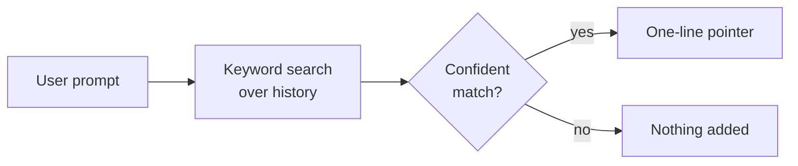

# On hold: per-turn pointers

**Status:** tabled. Revisit only if agents miss relevant history that the
recent-work block and `history_search` should have surfaced.

## Idea

On each user prompt, search history with the prompt and add a one-line pointer
to the best-matching earlier session (date, title, ID), not its content. The
agent then decides whether to open it with `history_search`.

## Why it is on hold

| Concern | Detail |
|---|---|
| Precision unknown | Prompts aren't phrased like searches. A wrong pointer costs attention every turn, and nobody has measured how often the top match is useful. |
| Prompt cache | The pointer changes every turn. It must be attached to that turn's user message and replayed identically afterwards, never added to the system prompt, or every request reprocesses the whole conversation. |
| Overlap | The frozen recent-work block already covers "what was I doing in this project". |

## How to test it, when revisited

The partial comparison on 26 Oct 2026 built the parts:

1. Take about 60 real first prompts of top-level sessions, each searched only
   against history from before it was asked, excluding its own session.
2. Have a model judge whether each prompt's top match would genuinely help: the same task, bug or decision, not just the same project or shared words.
3. Report the share of useful top matches overall and among the most
   confident 25% and 50% of prompts.
4. Ship only if the confident half is right at least about 80% of the
   time, with a score threshold set from that result.

On the generated questions, keyword search alone found the right session in the
top 10 for 87/87 questions that reused the original words and 60/87 that were
reworded. Embeddings were dropped as not worth an always-on model server.

The retired OptMem notes were dropped after a check on 61 of them: search found
the right session for most, and `open` reads any result's message whole.
